# The Windows 11 file explorer styling guide

## Table of contents

* [Introduction](#introduction)
  * [Finding targets](#finding-targets)
  * [What can't be styled](#what-cant-be-styled)
  * [Missing customizations](#missing-customizations)
  * [Contributing](#contributing)
* [Themes](#themes)
* [Explorer frame container height](#explorer-frame-container-height)
* [Translucent background effect](#translucent-background-effect)
* [Rows](#rows)
  * [Swap the navigation bar and the command bar](#swap-the-navigation-bar-and-the-command-bar)
* [Tab](#tab)
  * [Tab text font and color](#tab-text-font-and-color)
  * [Selected tab background](#selected-tab-background)
  * [Tab shape and state colors](#tab-shape-and-state-colors)
  * [Tab size and spacing](#tab-size-and-spacing)
  * [Hide the line under the tabs](#hide-the-line-under-the-tabs)
  * [Hide tab parts](#hide-tab-parts)
  * [Remove the tab strip](#remove-the-tab-strip)
* [Navigation Bar](#navigation-bar)
  * [Navigation bar background](#navigation-bar-background)
  * [Hide navigation buttons](#hide-navigation-buttons)
  * [Address bar background and corners](#address-bar-background-and-corners)
  * [Search box background and corners](#search-box-background-and-corners)
  * [Address bar and search box height](#address-bar-and-search-box-height)
  * [Hide the search box](#hide-the-search-box)
* [Command Bar](#command-bar)
  * [Command bar background](#command-bar-background)
  * [Button colors](#button-colors)
  * [Hide command bar separators](#hide-command-bar-separators)
  * [Hide the Details button](#hide-the-details-button)
  * [Hide specific command bar buttons](#hide-specific-command-bar-buttons)
  * [Remove the command bar](#remove-the-command-bar)
* [Details pane](#details-pane)
  * [Details pane background](#details-pane-background)
  * [Details pane thumbnail background](#details-pane-thumbnail-background)
* [Home Page](#home-page)
   * [Home page background](#home-page-background)
* [Gallery Page](#gallery-page)
   * [Gallery page background](#gallery-page-background)
* [Context menus and tooltips](#context-menus-and-tooltips)
   * [Context menu background and border](#context-menu-background-and-border)
   * [Context menu icon row](#context-menu-icon-row)
   * [Other menus](#other-menus)
   * [Tooltips](#tooltips)
* [Visual states](#visual-states)
* [Transforms](#transforms)
  * [Translate](#translate)
  * [Rotate](#rotate)
  * [Scale](#scale)
  * [Skew](#skew)
  * [Other properties and attributes](#other-properties-and-attributes)
* [Colors](#colors)
  * [Solid color](#solid-color)
  * [Accent colors](#accent-colors)
  * [Transparent color](#transparent-color)
  * [Acrylic effect as color](#acrylic-effect-as-color)
  * [WindhawkBlur effect as color](#windhawkblur-effect-as-color)
  * [Mica effect as color](#mica-effect-as-color)
  * [Gradient as color](#gradient-as-color)
  * [Image as color](#image-as-color)

## Introduction

This is a collection of commonly requested file explorer styling customizations for
Windows 11. It is intended to be used with the [Windows 11 File Explorer Styler](https://windhawk.net/mods/windows-11-file-explorer-styler) Windhawk mod.

If you're not familiar with Windhawk, here are the steps for installing the mod:

* Download Windhawk from [windhawk.net](https://windhawk.net/) and install it.
* Go to "Mods" in the upper right menu.
* Find and install the "Windows 11 File Explorer Styler" mod.

After installing the mod, open its Settings tab and adjust the styles according
to your preferences.

Some customizations are best adjusted with other Windhawk mods. Links to those
mods are provided where applicable.

**See also**: \
[The Windows 11 start menu styling
guide](https://github.com/ramensoftware/windows-11-start-menu-styling-guide/blob/main/README.md), \
[The Windows 11 taskbar styling
guide](https://github.com/ramensoftware/windows-11-taskbar-styling-guide/blob/main/README.md), \
[The Windows 11 notification center styling
guide](https://github.com/ramensoftware/windows-11-notification-center-styling-guide/blob/main/README.md).

### Finding targets

[How to find targets using UWPSpy](https://github.com/bbmaster123/FWFU/blob/main/Guides/uwpspy.md).

### What can't be styled

The mod can only style the parts of the window that are built with XAML: the
tabs, the navigation bar, the command bar, the details pane, the Home and
Gallery pages, and some of the menus and tooltips.

The file list (in any layout, including "Details"), the sidebar and the status
bar aren't built with XAML, so the mod can't change their colors, fonts, text
size or row spacing. The one exception is the [translucent background
effect](#translucent-background-effect), which can cover the entire window. For
the sidebar, check out the [Explorer TreeItem
Tweaker](https://windhawk.net/mods/explorer-treeitem-tweaker) mod.

### Missing customizations

If you're looking for a customization that is not listed here, please [open an
issue](https://github.com/ramensoftware/windows-11-file-explorer-styling-guide/issues/new).

### Contributing

If you have a file explorer styling customization or theme that you would like to
share, please submit a pull request.

## Themes

Themes are collections of styles that can be imported into the Windows 11
File Explorer Styler mod. The following themes are available:

| Link | Screenshot
| ---- | ----------
| [Translucent Explorer11](Themes/Translucent%20Explorer11/README.md) | [](Themes/Translucent%20Explorer11/screenshot.png)
| [MicaBar](Themes/MicaBar/README.md) | [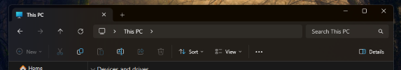](Themes/MicaBar/screenshot.png)
| [NoCommandBar](Themes/NoCommandBar/README.md) | [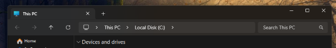](Themes/NoCommandBar/screenshot.png)
| [Minimal Explorer11](Themes/Minimal%20Explorer11/README.md) | [](Themes/Minimal%20Explorer11/screenshot.png)
| [Tabless](Themes/Tabless/README.md) | [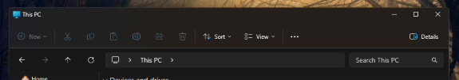](Themes/Tabless/screenshot.png)
| [Matter](Themes/Matter/README.md) | [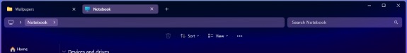](Themes/Matter/screenshot.png)
| [WindowGlass](Themes/WindowGlass/README.md) | [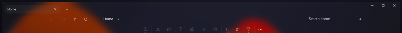](Themes/WindowGlass/screenshot.png)
| [AddressSearchOnly](Themes/AddressSearchOnly/README.md) | [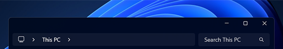](Themes/AddressSearchOnly/screenshot.png)
| [TintedGlass](Themes/TintedGlass/README.md) | [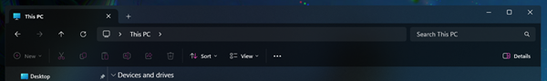](Themes/TintedGlass/screenshot.png)
| [LiquidGlass](Themes/LiquidGlass/README.md) | [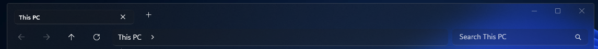](Themes/LiquidGlass/screenshot.png)
| [MicaTabless](Themes/MicaTabless/README.md) | [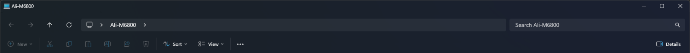](Themes/MicaTabless/screenshot.png)
| [OS26 Liquid Glass](Themes/OS26%20Liquid%20Glass/README.md) | [](Themes/OS26%20Liquid%20Glass/screenshot.png)
| [ZEUSosX_044](Themes/ZEUSosX_044/README.md) | [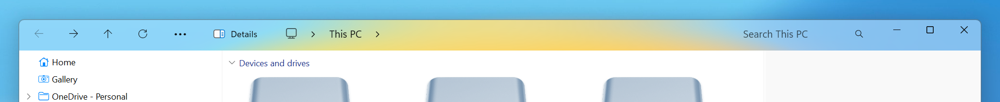](Themes/ZEUSosX_044/screenshot.png)
| [Compact Explorer11](Themes/Compact%20Explorer11/README.md) | [](Themes/Compact%20Explorer11/screenshot.png)
| [Float](Themes/Float/README.md) | [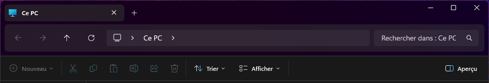](Themes/Float/screenshot.png)

## Explorer frame container height

The height of the explorer frame container, which includes the tabs, the address
bar, and the command bar; set it to zero to use the default height. The height
can be adjusted in the mod settings.

Lower the height after removing or merging rows so that no empty space is left
behind.

## Translucent background effect

The "Translucent background effect" mod setting applies an effect to the File
Explorer window background: Blur (AccentBlurBehind), Acrylic, Mica or Mica Alt.
The "Translucent background effect region" setting chooses whether the effect
covers the entire window or only the File Explorer frame.

Elements with their own background hide the effect, so make them transparent
too, for example the [navigation bar](#navigation-bar-background), the [command
bar](#command-bar-background), the [details pane](#details-pane-background), the
[Home page](#home-page-background) and the [Gallery
page](#gallery-page-background). The [Translucent
Explorer11](Themes/Translucent%20Explorer11/README.md) theme is a good starting
point.

The mod's effects don't apply to windows with the legacy frame. For those windows,
or for additional effects, set this option to "Windows default" and use the
[Translucent Windows](https://windhawk.net/mods/translucent-windows) mod.

## Rows

The top of the window is a grid with three rows: the tabs (`Grid.Row=0`), the
navigation bar (`Grid.Row=1`) and the command bar (`Grid.Row=2`). Setting
`Grid.Row` or `Grid.RowSpan` on these controls moves them between rows.

To fit the tabs and the navigation bar into one row, see the [Minimal
Explorer11](Themes/Minimal%20Explorer11/README.md) theme.

### Swap the navigation bar and the command bar

Target:
```
FileExplorerExtensions.NavigationBarControl
```
Style:
```
Grid.Row=2
```

Target:
```
FileExplorerExtensions.CommandBarControl_Wave1, FileExplorerExtensions.CommandBarControl
```
Style:
```
Grid.Row=1
```

## Tab

### Tab text font and color

Target:
```
Grid#TabContainer > ContentPresenter > StackPanel > TextBlock
```
Styles:
```
Foreground=Magenta
FontFamily=Segoe UI
FontWeight=Normal
```

### Selected tab background

To style the other tabs too, see [Tab shape and state
colors](#tab-shape-and-state-colors).

Target:
```
TabViewItem > Grid#LayoutRoot > Canvas > Microsoft.UI.Xaml.Shapes.Path#SelectedBackgroundPath
```
Style:
```
Fill=#00FFFF
```

### Tab shape and state colors

Replaces the default tab shape with a rounded rectangle that has a background
for each [visual state](#visual-states).

Target:
```
TabViewItem > Grid#LayoutRoot > Canvas
```
Style:
```
Visibility=Collapsed
```

Target:
```
TabViewItem > Grid#LayoutRoot > Grid#TabContainer
```
Styles:
```
Background=Transparent
BorderThickness=0
```

Target:
```
TabViewItem > Grid#LayoutRoot
```
Styles:
```
CornerRadius=5
Margin=2,4,0,4
Height=29
```

Target:
```
TabViewItem > Grid#LayoutRoot@CommonStates
```
Styles:
```
Background@Normal:=<SolidColorBrush Color="#808080" Opacity="0.05"/>
Background@PointerOver:=<SolidColorBrush Color="#808080" Opacity="0.15"/>
Background@Selected:=<SolidColorBrush Color="#808080" Opacity="0.35"/>
Background@PointerOverSelected:=<SolidColorBrush Color="#808080" Opacity="0.35"/>
Background@PressedSelected:=<SolidColorBrush Color="#808080" Opacity="0.35"/>
```

If curved corners remain next to the selected tab, hide them too.

Target:
```
Microsoft.UI.Xaml.Shapes.Path#LeftRadiusRenderArc, Microsoft.UI.Xaml.Shapes.Path#RightRadiusRenderArc
```
Style:
```
Visibility=Collapsed
```

### Tab size and spacing

Target:
```
TabViewItem
```
Styles:
```
Width=150
Margin=0,0,8,0
```

### Hide the line under the tabs

Target:
```
Border#BottomBorderLine, Border#LeftBottomBorderLine, Border#RightBottomBorderLine
```
Style:
```
Visibility=Collapsed
```

### Hide tab parts

Use the target for each part you want to hide.

Close button:
```
Grid#TabContainer > Button#CloseButton
```
Icon:
```
Grid#TabContainer > Viewbox#IconBox
```
Add button:
```
Grid#TabContainerGrid > Border > Button#AddButton
```
Style:
```
Visibility=Collapsed
```

### Remove the tab strip

Removes the whole row, including the add button. The minimize, maximize and
close buttons stay in place, so the navigation bar needs a top margin to clear
them.

Target:
```
FileExplorerExtensions.FileExplorerTabControl
```
Style:
```
Visibility=Collapsed
```

Target:
```
FileExplorerExtensions.NavigationBarControl
```
Styles:
```
Grid.Row=0
MinHeight=48
Margin=0,26,0,1
```

Then set the [Explorer frame container
height](#explorer-frame-container-height) to about 123. The
[AddressSearchOnly](Themes/AddressSearchOnly/README.md) theme uses 80, which
also crops the command bar out of view.

## Navigation Bar

### Navigation bar background

Target:
```
Grid#NavigationBarControlGrid
```
Style:
```
Background:=<SolidColorBrush Color="Gray" Opacity="0.4"/>
```

### Hide navigation buttons

Use the target for each button you want to hide. The stop button takes the place
of the refresh button while a folder is loading, so hide both.

Targets:
```
AppBarButton#backButton

AppBarButton#forwardButton

AppBarButton#upButton

AppBarButton#refreshButton

AppBarButton#stopButton
```
Style:
```
Visibility=Collapsed
```

### Address bar background and corners

Target:
```
FileExplorerExtensions.AddressBarControl > Grid#PART_LayoutRoot
```
Styles:
```
Background=#FFFF00
CornerRadius=6
```

The address bar turns into a text box when clicked. To round its corners too:

Target:
```
AutoSuggestBox#PART_AutoSuggestBox > Grid#LayoutRoot > TextBox#TextBox
```
Style:
```
CornerRadius=6
```

### Search box background and corners

Target:
```
AutoSuggestBox#FileExplorerSearchBox > Grid#LayoutRoot > TextBox > Grid@CommonStates > Border#BorderElement
```
Styles:
```
Background=#FFFF00
CornerRadius=6
BorderThickness=0
```

### Address bar and search box height

Targets:
```
Grid#FileExplorerAddressBarGrid

AutoSuggestBox#FileExplorerSearchBox
```
Style:
```
Height=28
```

### Hide the search box

Target:
```
AutoSuggestBox#FileExplorerSearchBox
```
Style:
```
Visibility=Collapsed
```

To let the address bar fill the free space:

Target:
```
Grid#FileExplorerAddressBarGrid
```
Style:
```
Grid.ColumnSpan=2
```

## Command Bar

### Command bar background

Targets:
```
FileExplorerExtensions.CommandBarControl_Wave1 > Grid, Grid#CommandBarControlRootGrid

CommandBar#FileExplorerCommandBar
```
Style:
```
Background=Transparent
```

### Button colors

Applies to the buttons of both the command bar and the navigation bar. To style
a single button, add its name, for example `AppBarButton#backButton`. See
[Visual states](#visual-states) for more about the states.

Target:
```
AppBarButton > Grid#Root@CommonStates > Border#AppBarButtonInnerBorder
```
Styles:
```
Background@PointerOver:=<SolidColorBrush Color="#808080" Opacity="0.15"/>
Background@Pressed:=<SolidColorBrush Color="#808080" Opacity="0.25"/>
```

### Hide command bar separators

Target:
```
AppBarSeparator
```
Style:
```
Visibility=Collapsed
```

### Hide the Details button

Hides the right end of the command bar, which holds the Details button.

Target:
```
CommandBar#FileExplorerSecondaryCommandBar
```
Style:
```
Visibility=Collapsed
```

### Hide specific command bar buttons

Most command bar buttons have no name, so they're matched by their tooltip.
Tooltips depend on the Windows language, and these examples are for English:
`Cut`, `Copy`, `Paste`, `Rename`, `Share`, `Delete`.

Target:
```
AppBarButton[ToolTipService.ToolTip = Cut]
```
Style:
```
Visibility=Collapsed
```

The Sort button has a name, so it can be matched in any language with
`AppBarButton#SortAndGroupButton`.

A button can also be matched by its position, which works in any language but
can break when a Windows update changes the buttons. For example, Cut is the
third child, counting separators:
```
CommandBar#FileExplorerCommandBar > * > AppBarButton[3]
```

### Remove the command bar

Target:
```
FileExplorerExtensions.CommandBarControl_Wave1, FileExplorerExtensions.CommandBarControl
```
Style:
```
Visibility=Collapsed
```

Target:
```
FileExplorerExtensions.NavigationBarControl
```
Styles:
```
Grid.RowSpan=2
Margin=0,0,0,1
```

Then set the [Explorer frame container
height](#explorer-frame-container-height) to 87.

## Details pane

The pane that shows information about the selected item. It can be toggled with
the "Details" button in the command bar or with Alt+Shift+P. It's different from
the "Details" layout of the file list, which [can't be
styled](#what-cant-be-styled).

### Details pane background

Target:
```
Grid#DetailsViewControlRootGrid
```
Style:
```
Background=#FFFF00
```

### Details pane thumbnail background

Target:
```
StackPanel#DetailsViewThumbnail > Grid
```
Style:
```
Background=#FFFF00
```

## Home Page

### Home page background

Target:
```
Grid#HomeViewRootGrid
```
Style:
```
Background=#FFFF00
```

## Gallery Page

### Gallery page background

Targets:
```
FileExplorerExtensions.GalleryViewControl#GalleryViewControl > Grid

FileExplorerExtensions.GalleryViewControl#GalleryViewControl > Grid > Grid#GalleryRootGrid
```
Style:
```
Background=Transparent
```

## Context menus and tooltips

### Context menu background and border

Applies to the right-click menu and to the command bar's "See more" menu.

Target:
```
CommandBarOverflowPresenter#SecondaryItemsControl > Grid#LayoutRoot
```
Styles:
```
Background=#FFFF00
BorderBrush=#00FFFF
BorderThickness=1
CornerRadius=8
```

When changing the corner radius, also target `Grid#OuterOverflowContentRootV2`
with the same `CornerRadius`.

> [!NOTE]
> Windows doesn't support translucent effects for these menus, so use an opaque
> color. The [WindowGlass](Themes/WindowGlass/README.md) theme uses a nearly
> opaque `AcrylicBrush` for a similar look.

### Context menu icon row

The row of icons at the top of the right-click menu.

Target:
```
Microsoft.UI.Xaml.Controls.Primitives.CommandBarFlyoutCommandBar > Grid#LayoutRoot > Grid#OuterContentRoot > Grid#ContentRoot > Grid#PrimaryItemsRoot
```
Styles:
```
Background=#FFFF00
BorderBrush=#00FFFF
BorderThickness=1
CornerRadius=8
```

### Other menus

Some other menus use a different control.

Target:
```
MenuFlyoutPresenter > Border
```
Styles:
```
Background=#FFFF00
BorderBrush=#00FFFF
BorderThickness=1
CornerRadius=8
```

### Tooltips

Target:
```
ToolTip
```
Styles:
```
Background=#FFFF00
BorderBrush=#00FFFF
BorderThickness=1
CornerRadius=8
```

## Visual states

Some elements change their look depending on their state, for example when
hovered or pressed. To set a style for a specific state, add the visual state
group name to the target with `@`, and the state name to the style with `@`.

For example, to change the color of a tab when hovered, target:
```
TabViewItem > Grid#LayoutRoot@CommonStates
```
Style:
```
Background@PointerOver:=<SolidColorBrush Color="#808080" Opacity="0.15"/>
```

A style without a state applies to every state of the group that doesn't have
its own value for that property.

The most common group is `CommonStates`. Its states depend on the element:

| Element | Target | States
| ------- | ------ | ------
| Tabs | `TabViewItem > Grid#LayoutRoot@CommonStates` | `Normal`, `PointerOver`, `Pressed`, `Selected`, `PointerOverSelected`, `PressedSelected`
| Buttons | `AppBarButton > Grid#Root@CommonStates` | `Normal`, `PointerOver`, `Pressed`, `Disabled`
| Text boxes | `TextBox > Grid@CommonStates` | `Normal`, `PointerOver`, `Focused`, `Disabled`

See [Finding targets](#finding-targets) on how to use UWPSpy to find all of the
available visual states for an element.

## Transforms

You can use transformation styles to translate, rotate, scale, or skew elements.

> [!TIP]
> **Should I use `RenderTransform` or `Transform3D`?**
>
> For 2D transformations, it is best to stick to `RenderTransform` in most cases. Using `Transform3D` for 2D transformations can cause elements to become blurry. For 3D transformations, you must use `Transform3D`.

> [!TIP]
> You can mix and match transformations when using `Transform3D`! You can also use `RenderTransform` and `Transform3D` together.
>
> For example: `Transform3D:=<CompositeTransform3D ScaleX="1.5" TranslateY="-15" RotationZ="15" />`

### Translate

```
RenderTransform:=<TranslateTransform X="15" Y="-15" />
```

-- or --

```
Transform3D:=<CompositeTransform3D TranslateX="15" TranslateY="-15" TranslateZ="-15" />
```

### Rotate

```
RenderTransform:=<RotateTransform Angle="15" />
```

-- or --

```
Transform3D:=<CompositeTransform3D RotationX="-15" RotationY="15" RotationZ="-15" />
```

- `X`: 3D vertical rotation.
- `Y`: 3D horizontal rotation.
- `Z`: 2D rotation.

### Scale

```
RenderTransform:=<ScaleTransform ScaleX="1.5" ScaleY="-1.5" />
```

-- or --

```
Transform3D:=<CompositeTransform3D ScaleX="-1.5" ScaleY="1.5" ScaleZ="-1.5" />
```

### Skew

```
RenderTransform:=<SkewTransform AngleX="-15" AngleY="15" />
```

### Other properties and attributes

- Applies to Rotate, Scale and Skew:
  - `CenterX`: Offsets the transform's origin on the X axis.
  - `CenterY`: Offsets the transform's origin on the Y axis.
  - `CenterZ`: Offsets the transform's origin on the Z axis. (Only for `Transform3D`)

  Example:
  ```
  RenderTransform:=<RotateTransform Angle="15" CenterX="10" CenterY="20" />
  ```
- `RenderTransformOrigin`
  - Applies to `RenderTransform` only, `Transform3D` does not support this attribute. It is a separate attribute and is not set inside of the `RenderTransform` like `CenterX/Y/Z`.
  - Sets the transform origin relative to its target's width and height. Format is `X,Y` and both numbers range from 0-1.

  Example:

  ```
  RenderTransformOrigin=0.5,0.5
  ```
  This centers the transform's origin.
- `TransformGroup`
  - Applies to `RenderTransform` only, `Transform3D` does not support this attribute. It is a separate attribute and is not set inside of the `RenderTransform` like `CenterX/Y/Z`.
  - Allows you to combine RenderTransforms together into one style, mimicking Transform3D's functionality.

  Example:
  ```
  RenderTransform:=<TransformGroup><RotateTransform Angle="15" /><TranslateTransform X="15" Y="-15" /></TransformGroup>
  ```

## Colors

In the following examples, we're going to use `Fill` as an example, but this
also works for other properties that accept colors, like `Background`.

### Solid color

```
Fill=<color>
```

Replace `<color>` with the desired color.

A color can be a name (e.g. `Red`) or a hex code (e.g. `#FF0000`).

The color can be semi-transparent (e.g. `#80FF0000`). To have a fully
transparent background, use `Transparent`.

### Accent colors

A color can also be a `ThemeResource` or `StaticResource`. There are many such
styles built into Windows.

```
Fill:=<SolidColorBrush Color="{ThemeResource SystemAccentColor}" Opacity="0.8" />
```

Accent colors have different lightness available, like `SystemAccentColorLight2`
or `SystemAccentColorDark1`. The word `Light` or `Dark` is appended at the end
with a number ranging from 1 to 3. Check out [the official Microsoft
docs](https://learn.microsoft.com/en-us/windows/apps/design/style/color#accent-color-palette)
for all variations.

```
Fill:=<SolidColorBrush Color="{ThemeResource SystemAccentColorDark2}" Opacity="0.5" />
```

### Transparent color

To have a fully transparent background, use the following style:

```
Fill=Transparent
```

### Acrylic effect as color

In order to have an acrylic effect (a blurred background), you can use
`AcrylicBrush`. It comes with `TintOpacity`, which defines how much of the color
needs to be applied.

```
Fill:=<AcrylicBrush TintColor="Black" TintOpacity="0.8" />
```

You can also mix acrylic with a variation of an accent color for a more dynamic
look that fits the current theme.

```
Fill:=<AcrylicBrush TintColor="{ThemeResource SystemAccentColorDark2}" TintOpacity="0.3" />
```

### WindhawkBlur effect as color

An alternative to Acrylic is the mod's own blur implementation called `WindhawkBlur`. It differs from Acrylic in that its blur radius, saturation and noise are customizable, and it keeps blurring when battery saver is on or transparency effects are off, unless `FallbackColor` is set.

> [!NOTE]
> WindhawkBlur does not currently support color names (e.g. `Red`).

- `BlurAmount`: Radius of blur effect (set to 30 to mimic Acrylic).
- `TintLuminosityOpacity`: Shifts pixel luminance towards the tint color's luminance. Range: 0.0 to 1.0.
- `TintSaturation`: Controls the saturation of the blurred content. 1.0 is unchanged, 0.0 is fully desaturated (grayscale).
- `NoiseOpacity`: Adds a procedural noise texture overlay. Controls how visible the noise is (0.0 to 1.0).
- `NoiseDensity`: Controls the granularity of the noise texture (defaults to 1.0).
- `FallbackColor`: Color used in place of the blur effect when battery saver is on or when transparency effects are disabled in the system settings. Accepts a hex color or a `ThemeResource`. If omitted, the blur effect is used regardless of those settings.

#### Hex color

```
Fill:=<WindhawkBlur BlurAmount="10" TintColor="#80ff0000" />
```
```
Fill:=<WindhawkBlur BlurAmount="10" TintColor="#ff0000" TintOpacity="0.5" />
```
_These examples set a blur that is tinted with red at 50% opacity. Both versions have the same effect._

- `TintColor`: Hex color in `#AARRGGBB` or `#RRGGBB` format that is applied to the blur.
- `TintOpacity`: Opacity of the color that overrides the alpha of `TintColor`.

> [!TIP]
> There is no need to specify a `TintOpacity` value if your `TintColor` has an alpha value.

#### ThemeResource color

```
Fill:=<WindhawkBlur BlurAmount="10" TintColor="{ThemeResource SystemAccentColor}" TintOpacity="0.5"/>
```

- `TintColor`: ThemeResource color, such as `SystemAccentColor`.
- `TintOpacity`: Overrides the opacity of the ThemeResource color.

### Mica effect as color

> [!NOTE]
> Unfortunately, it is not possible to set a Mica effect at this time with any of Windhawk's styler mods. To apply Mica to the window background instead, use the [translucent background effect](#translucent-background-effect) setting.

### Gradient as color

The background can also be a gradient. For example, to have a gradient from
yellow to red to blue to lime green, use the following style:

```
Fill:=<LinearGradientBrush StartPoint="0,0.5" EndPoint="1,0.5"><GradientStop Color="Yellow" Offset="0.0" /><GradientStop Color="Red" Offset="0.25" /><GradientStop Color="Blue" Offset="0.75" /><GradientStop Color="LimeGreen" Offset="1.0" /></LinearGradientBrush>
```

### Image as color

The background can also be an image:

```
Fill:=<ImageBrush Stretch="UniformToFill" ImageSource="<image>" />
```

Replace `<image>` with your own image, a URL or a local file path.
